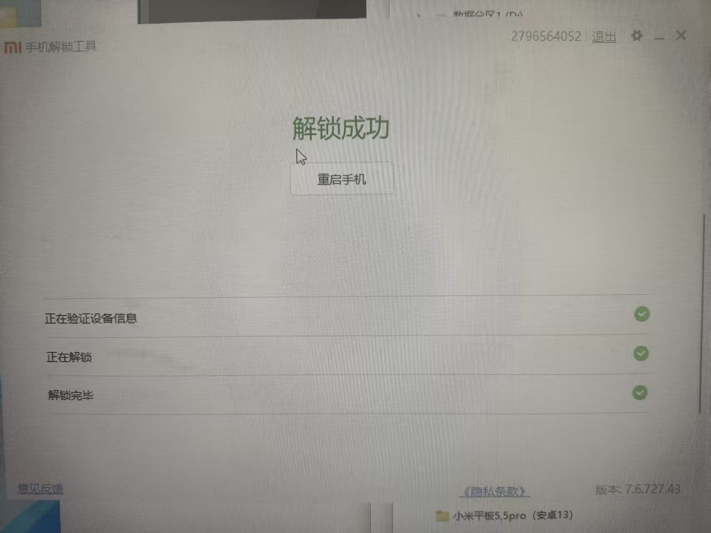
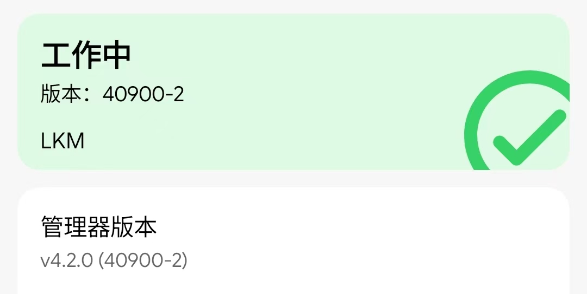
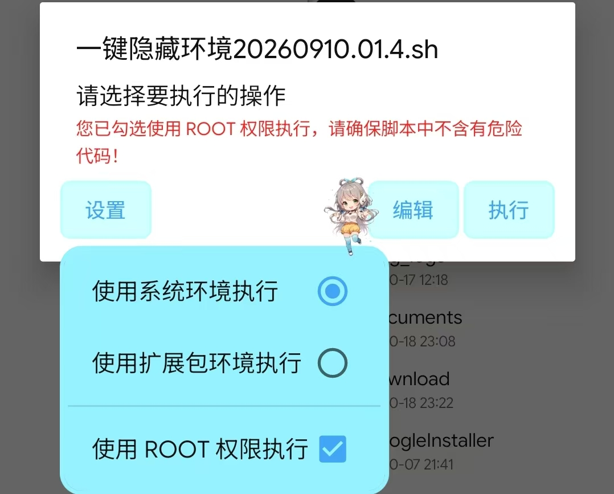
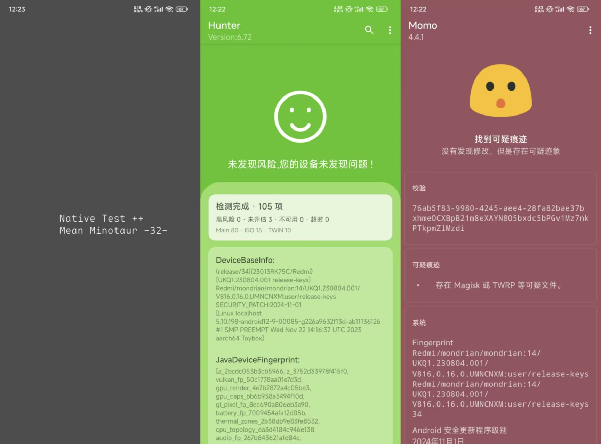
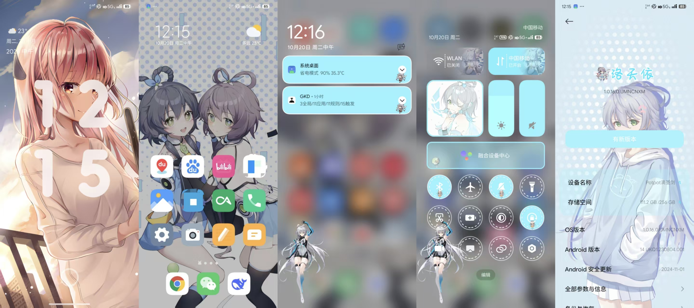

# 起因
上周一(10.5) 在学校国庆集训的时候, 和一个人聊起了手机, 然后我说我想root, 他给我推荐了一加.

但是呢, 由于我前一天晚上搜到了GhostLock临时root的教程, 导致我有了"通过漏洞解锁BL"的想法, 因此...
### 第零阶段: 基础知识复习
总之先看了一遍[极客湾玩机教程](https://www.bilibili.com/video/BV1BY4y1H7Mc), 这个教程对于有一个基础的理解来讲还是很好的, 但是一些细节上的东西讲的不是很细, 导致我当时(23年的时间也想过root)并不知道root的具体流程.

但是现在就不一样了, 现在有神奇的AI大人, 有不懂的随时都可以问AI, 真得感慨一下科技的进步呀~

那么, 在看完视频之后就开始吧.
## 分区
在未刷机的时候, 是看不到完整根目录的, 但是了解一些安卓的文件结构还是尤为重要的.
- system 顾名思义, 存放系统
- boot 系统的启动分区, 见下方[启动阶段](#启动阶段)
- init_boot Android13引入, 存放安卓系统通用文件, 相对的, 此版本以后boot分区存放厂商定制内容, 所以刷机也基本只动这个分区 ^init
- recovery 还原分区, 类似于Win PE, 提供刷入/备份功能, 在Android 8引入了A/B分区的概念, 所以现在的机型会出现recovery_a 和recovery_b两个分区(boot也同理) ^143028
- storage 存储设备挂载目录, 比如data/sdcard为/storage/emulated/0, 相信各位用过mt管理器的都很熟了~
- etc 存放配置文件, 指向/system/etc, 重启后恢复(像软格机指的就是删这个, 因为重启下又回来了)
- cust 厂商定制分区
- vendor 厂商驱动
- modem 基带, 唯一, 重要!
### Kind of FAQ
- 字库是什么? 手机闪存(eMMC/UFS), 备份字库即全盘备份
- ROM是什么? 虽然更多用的是只读存储器(Read Only Memory), 但是刷机语境下指的是一份全盘镜像, 可以简单理解为WIn的iso文件, 不过是由多个分区的镜像组成, 会把对应镜像刷入到对应分区
## 启动阶段
此处以高通为例
1. 芯片上电, 固化在片上的PBL(Primary Bootloader)
	1. 初始化时钟等
	2. 校验签名后引导XBL(eXtensible Bootloader)
	3. 或 XBL损坏/短接USB, 进入高通EDL(Emergency Download Mode)9008模式, 叫9008是因为在电脑上会开一个9008的串口
2. XBL
	1. 初始化内存等
	2. 验证底层固件
	3. 校验签名后加载TEE(TrustZone), 独立运行在芯片EL3(最高特权级别),提供密钥验证等服务
	4. 校验签名后加载ABL(Android Bootloader), 这就是常说的Bootloader
3. ABL
	1. 读取设备解锁状态
	2. 读取按键状态
	3. 读取boot/init_boot并验证签名(也就是BL锁)
	4. 或 按下音量下+电源, 进入Fastboot线刷模式, 小米以前是米兔, 现在变成纯红色FASTBOOT了. 连接电脑可以使用fastboot命令进行基础刷入了
	5. 3/4的时候亮第一屏
4. boot/init_boot
	1. AVB(Android Verified Boot)校验 验证system/vendor等分区签名
	2. 挂载根文件系统, 不挂recovery这些哦
	3. 启动init进程(PID=1), 进入用户空间(学过LInux的各位, 眼熟吧)
	4. 或 检查ABL留下的参数, 进入Recovery/Fastbootd模式, 提供更全面的功能
5. 亮起第二屏, 初始化系统
6. 跳出锁屏界面, 启动完成

## 关于Android
一些名词解释
- GKI Generic Kernel Image 同上[init_boot](#^init), 在A12引入, 旨在隔离安卓与厂商内核文件
- LKM Loadable Kernel Module 在内核启动阶段挂载, 从而实现在启动阶段加载模块代码/获取root ^27cad2
- KMI Kernel Module Interface GKI的接口
- 内核版本 出厂的Android版本, 一般不会变. 指的是boot/init_boot里从Linux里fork出来的Android分支内核
- 系统版本 随着系统更新变化, 提供顶层API
### 怎么区分什么语境下是内核/系统版本
- 如果这个东西需要在system启动前就加载, 那就是内核版本, 反之亦然
- 如果这个东西动了boot/init_boot, 那就是内核版本, 反之亦然
- 如果这个东西前面跟的是内核版本号(5.x.xxx这种), 那就是内核版本, 反之是OS版本号亦然. ^6afc96
- 比如KSU, 修补boot.img的时候问你安卓版本是什么, 就是内核版本.

怎么样, 看完是不是一脸懵逼, 不过没关系, 有个印象就好了, 反正后面再回来翻也可以嘛.

总之, 可以正式开始喽~
# 第一阶段: 解锁Bootloader
这是刷机的第一步, 也是最难的一步. 可能是命运所限, 也可能是厂商作孽.

近年来, 厂商们都犹如呵护自己gm一样收紧了解锁BL的资格, 这并不是很有效的打击了黑灰产, 但是极大的阻碍了刷机小白们. ~~这是件好事儿啊!~~

如果你是一加, 你当我没说, 社区60天绑定7天直接解就完事.

However, 如果你是小米, 那你可算是来对地方了, 你再也不用去社区老老实实签到一年参加小米高考被社区那帮人当猴耍了, 

至于vivo/鸿蒙, 当然你想解的话, 也可以去猫妈那里付费解. 不过你都用鸿蒙了, 肯定是很看重安全性和爱国性的, 对吧.(doge

总之, 这里汇总了一些漏洞临时root/免解BL/绕社区的一些方法, 能帮一点是一点咯~
## Xiaomi-HyperOS-bypass
感谢[这个视频](https://www.bilibili.com/video/BV1qXFazTE28)让我知道了绕社区这玩意的存在, 感谢猫妈([MlgmXyysd](https://github.com/MlgmXyysd))提供的[绕社区脚本](https://github.com/MlgmXyysd/Xiaomi-HyperOS-BootLoader-Bypass).

### 实现原理
首先得先搞明白正常小米解BL的阶段:
1. 社区签签签签签签到 签一年, 签到社区5级.
2. 无违规, 去等可能随时开的小米解锁BL资格考试(小米高考)
3. 开启OEM解锁, 绑定设备.
	1. 发送你的设备型号
	2. 询问小米社区是否符合条件(MIUI用户跳过这一步, 记笔记!!!)
	3. 服务器建档, 开始计时168小时
4. 下载MiFlash(以下大段可以后面再回来看)
	1. 登录小米账号
	2. 连电脑, 进Fastboot
	3. MiFlash里点解锁
		1. 验证设备信息(解锁资格)
		2. 解锁, 刷入有官方签名的固件包, 擦除data
5. 解锁成功

其实到这就很明显了, 就是利用MIUI可以直接解的特性, 在**绑定时修改向服务器上传的系统版本**为MIUI, 这样服务器就不会去社区校验解锁资格, 直接建档, 开始计时.

但是, 这个绕社区的方法只能在**出厂MIUI, 后升级至OS1**的机型上用. 因为OS1时期, 小米使用了**固定的对称加密密钥**, 通过逆向可以直接拿到, 因此解密手机和服务端的通信, 实现类似于中间人攻击的东西(性质上差不多), 从而修改系统版本.

不过OS2/3/4以及出厂hyperOS的各位也别灰心, 看下面, 而且更何况得益于AI神力, Linux/Android的漏洞是三天两头的有, 所以肯定是有机会的.

### 操作流程
提前做好心理准备, 此方法不一定100%成功, 有可能出现被服务端风控卡144小时的情况. 据传言, 23年以前的活跃老账号可以有效降低风控.

参考酷安[关于如何使用XBHBB工具跳过HyperOS社区解锁的5级限制](https://www.coolapk.com/feed/62395559).

就简述一下我的流程吧:
1. 下载文中的`BypassTool.zip`, 当然你自己组装也可以的.
2. 打开开发者模式, OEM解锁, USB调试, USB调试(安全设置)
3. 能打的驱动都打上, 手机连接电脑, 开启移动网络, 运行`Bypass.cmd`
4. 第一次报错401, 重新登录小米账号即可.
5. 第二次报错10000, 需要降级`Settings.apk`, 具体地:
	1. 下载文中的`解决10000报错.zip`
	2. 找到自己机型的apk, 解压缩
	3. 用Platform Tools或者Bypass脚本的lib里找到adb.exe, 然后在cmd打开当前位置.
	4. `adb install <对应Settings.apk路径>`
	5. 重新运行Bypass脚本.
6. 如果到这再报30001就是没救了, 86015(风控)就是大概率没救.
7. 备份数据!!! 别管什么168小时倒计时抱着试试的心态解锁.(本人因此丢失2年照片)
8. 看一眼自己的SIM卡密码, 解完锁要输.
9. 下载[MiFlash Unlock](https://www.miui.com/unlock/index.html)
10. 登录小米账号
11. 手机连接电脑. 关机, 然后按住电源和音量下进入Fastboot
12. 等解锁工具识别到设备, 点解锁设备
13. 过程中不要拔掉数据线! 过程中不要拔掉数据线! 过程中不要拔掉数据线!(这是常识)
14. 解锁成功/提示168h.
15. 如果等几天发现还是144h那就是被风控了, 没招了.

总之, 可能得益于我小米社区23年注册的5级号老资历, 也是连168小时都不用等就解锁了, 炫耀一下:不要问为什么是手机拍屏幕, 用的机房电脑.

## 其他方式
### QC解锁
这是[莫离然然](https://www.coolapk.com/u/10828415)在高通机型上发现的, 流程为:
1. 利用漏洞宽容SELinux
2. 刷入工程ABL
3. 降级MIUI工程包
4. 利用MIUI免答题机制解锁

具体操作流程见[博客](http://moliranran.com:92/archives/wei-ming-ming-wen-zhang)和[酷安](https://www.coolapk1s.com/feed/71068455)

适用范围是晓龙8Gen1-8E5 的26-2月补丁之前的小米/红米机型, 并且8Gen1/8+Gen1需要OS2+
### 3.8解锁节
### 5.1解锁节
### GhostLock
### Unlock Tools
# 第二阶段: 刷入root权限
到这一步相当于已经脱离了厂商的大手, 进入到真正"搞机"的范畴了, 也是终于不用看厂商脸色了, 好耶~

当然这也意味着你失去了保修(虽然我的早就过了), 变砖风险也增加了很多, 所以其实对心理素质的需求也是很大的.

之后我的计划就是:
1. 提取并在SukiSU中修补boot.img
2. 重启至Fastboot, 刷入TWRP
3. 重启至Recovery, 备份分区
4. 重启至Fastboot, 刷入SukiSU修补后的boot.img
## 提取并修补
## 选择root管理器
参考[各种主流安卓Root方式包括他们的原理和刷入方式大全](https://www.bilibili.com/video/BV1BYsdzvEt1)

总之我觉得, 只要你的设备兼容, 就刷SukiSU肯定是最好的, 如果想追求稳定, 那就是KernalSU.

经过一番精挑细选, 也是选择了SukiSU的方案. 其次当然是[LKM模式](#^27cad2)啦, 毕竟兼容性和成砖风险也相对较好.

这边也是先不小心进了[SukiSU的Github Release](https://github.com/SukiSU-Ultra/SukiSU-Ultra/releases/)下载了SukiSU的root管理器.

然后又不小心的进到了[hyperos.fans](https://hyperos.fans/)  找到了**对应机型对应系统版本的线刷包**(注意这边跟的就是安卓版本就是系统版本了, [因为](#^6afc96)

然后一个线刷包的文件结构如下(以Redmi K60 OS1.0.16.0_A14为例):


然后不小心用解压工具把里面的boot.img文件提取出来了, 注意到K60的**内核版本其实是A12**所以没有init_boot.img(即使系统版本是A14)

又非常不小心的下载了[Uotan Toolbox](https://toolbox.uotan.cn/), 然后我家猫把我数据线扯过来连接了手机和电脑并打开了USB调试.~~根本就不存在这样的猫~~

非常不小心的在Uotan Toolbox的文件管理里把对应的boot.img上传到了手机的内部存储(`/storage/emulated/0`)路径下.

最后尝试补救结果错误的在SukiSU里选择了**选择并修补一个文件**(也就是LKM模式)并选择了刚刚上传的boot.img, 在弹出的选择安卓版本中选择了**Android的内核版本(5.10-A12)** 然后修补完在同一个目录下生成了一个**KernalSU_patched开头的.img文件**, 错误的把这个文件通过Uotan Toolbox上传至了电脑.

然后发现我怎么这么不小心, 遂认命.

后来我发现有个特别屌的东西叫直接安装, 我一开始以为那是刷GKI的.

那那有人就要问了, *那GKI呢? 不是说卡刷更好, 为啥现在不卡刷了?*

那么这两个问题的答案分别是:
- GKI去[SukiSU社区构建](https://sukisu.org/zh/guide/links) 找Anykernal3开头的卡刷包, 然后用Recovery刷入
- LKM模式通常要对机型适配, 粒度较细, 并且只用刷入一个分区, 这时候让用户自己去分辨是刷哪个分区比让脚本判断更不容易出错. 而GKI模式则是直接把一套雷霆大内核镜像都刷进去, 粒度本来就不用那么大, 就可以直接用卡刷批量刷入更方便了.

## 刷入TWRP
TWRP, 也就是Team Win Recovery Project, 是一个功能强大的第三方recovery, 提供了刷入/备份等功能.

而这么好用的Recovery在哪里呢, 反正我是在[XDA里看到的SourceForge链接](https://sourceforge.net/projects/recovery-for-xiaomi-devices/)里下的, 红米K60的TWRP官方并没有维护, 是[skkk](https://www.coolapk.com/u/776857)大佬在维护.

总之下的时候千万注意别下错了, 一开始没注意下的`twrp-3.7.0_12-v7.9_A13-mondrian-skkk.img`, 后面发现没触控吓死我了. 不过后来重新刷个`twrp-3.7.1_12-v8.6_A14-mondrian-skkk.img`就好了.

那么具体怎么刷呢:
1. Uotan Toolbox主页里点重启至Bootloader
2. 在基本刷入里刷入Recovery(Uotan Toolbox会自动处理[AB分区](#^143028), 我就选择`twrp-3.7.1_12-v8.6_A14-mondrian-skkk.img`, 然后至Recovery就行了,如下图

最后重启至Recovery就可以看到那个"小米奇迹"字样(指的是奇迹般的A13触控失灵Bug吗, 虽然是我的问题)的TWRP了.

十分傻瓜式操作, 对吧~

之后在TWRP里把boot啦recovery啦modem啦都备份下, 然后继续打开Uotan ToolBox, 找到格式化&提取:
把boot_a啦boot_b啦recovery_a啦recovery_b啦modem输进去点那个物理分区, 当然你一键全盘备份也可以, 如果不嫌慢就行.

最后重启至Fastboot(尽量不要先进系统, 没刷root TWRP有可能会掉), 开始刷root.
## 刷入SukiSU
非常傻瓜的在Uotan ToolBox里找到自定义刷入然后:
选择刚才的KernalSU_Patched那个img文件(这也是为什么刚才要先修补的原因).

然后点刷入, 双手合十进行祈祷, Uotan ToolBox只会选择Boot_a和Boot_b中激活的那个刷入(这样如果炸了系统会自动切换到好的那个), 所以你看日志跑完boot_a卡住不要惊慌, 它其实只是刷完了.

再重启至系统打开SukiSU就可以看到:


# 第三阶段: 开始搞机
这里不一定是我的顺序, 不过肯定是最优的顺序, 反正看就对了.
## 隐藏环境
在刚root之后, 暂且是下了一些对安全性要求高的软件, 像是中国移动啦什么的.

但是光光这个我还是可以忍的, 但是后来QQ隔几个小时就退登一次我就忍不了了, 所以自然就需要隐藏root环境啦.

参考[传说中的小菜叶的一键隐藏环境脚本](https://www.coolapk.com/feed/73667862).

在[小菜叶的博客](https://blog.xiaocaiye.cn/archives/1788971183311)里面下载脚本.

注意运行这个脚本不能装任何模块, 就是SukiSU里不要装, 它会自动刷一堆模块, 如果你之前刷过模块可能会冲突.

非常傻瓜的在SukiSU里给MT管理器授权root然后打开MT管理器解压出来然后以root权限运行, 如下:

先别问这个洛天依怎么搞的, 在下一章节.

还有**千万不要运行来路不明的脚本**(如张豪全防.sh(doge), 而且**任何脚本**都建议看一眼里面的内容是什么(并重点关注**dd/rm**命令).

总之脚本先问你有没有把模块都卸干净, 卸干净了就按下Y.

之后运行全绿之后就可以直接重启了.

重启之后打开它帮你下好的Momo,Hunter,Native++就可以看到全绿了(不用管Momo那个可疑文件):



唯一美中不足的一点是因为这个搞太晚了, 所以QQ在过环境之前记录下了设备指纹, 被风控了, 后面就算过完环境了也不行.

另外QQ也有个模块叫[QAuxiliary](https://github.com/cinit/QAuxiliary), 提供了防撤回以及QQ美化的功能, 所以说用不了还是有点可惜的.
## 系统美化
那root之后其实无非就是性能调优和系统美化, 那系统美化也是更关乎体验的, 而且也是我先搞的, 所以先讲.
### LSPosed
这是本章节几乎所有(除了GKD)所依赖的底层框架了, 它本身是作为一个模块刷入到SukiSU的, 所以说可以在内核加载阶段就启动, 并提供了一些修改应用的API给挂载在它下面的模块用.

如果你没有先跑那个脚本可以看安装部分, 反之一样用脚本过完环境了会自动给你装好.
#### 安装
需要先下载一个模块, [Zygisk Next](https://github.com/LSPosed/ZygiskNext/), 这个东西干啥的下面再说.

之后去[LSPosed官网](https://lsposed.org)下LSPosed的最新版本, 注意不要去Github Release下, 看到哪里有问题了吗, 3 yeas ago(一开始下错了好多模块都提示旧API)

然后去SukiSU选择刷入就行了, 之后记得重启.(刷完模块都要重启的)

LSPosed默认是没有桌面快捷方式的(一开始我还以为没刷进去), 要么去SukiSU点执行, 要么去那个模块压缩包把里面的`Manager.apk`解压出来安装.
#### 原理
安卓启动的时候会有一个Zygote进程, 负责孵化(Fork)所有应用程序, 那么Zygisk就是做Hook这个Zygote进程用的.

那么就很明显了, 已经掌握了Zygote这一条主干道, 那LSPosed做的就是Hook某个特定的App(作用域), 然后下面挂载模块的代码再植入一些东西到App里.
## HyperCeiler西米露
这是一个功能非常强大的系统美化工具, 其实如果只是简单删删改改UI和预装的话用这个也就够了.

非常简单, 去[Github Release](https://github.com/ReChronoRain/HyperCeiler/releases)下载你对应OS版本的apk.
然后K60是A14, A14的最后一个稳定版本是[HyperCeiler_2.6.161_20250829_4237_release.apk](https://github.com/ReChronoRain/HyperCeiler/releases/download/2.6.161/HyperCeiler_2.6.161_20250829_4237_release.apk), 最后一个测试版本是[Android14-HyperCeiler_2.6.161_20251108_4257_beta.apk](https://github.com/ReChronoRain/HyperCeiler/releases/download/2.6.163/Android14-HyperCeiler_2.6.161_20251108_4257_beta.apk)

安装完之后在LSPosed里(在SukiSU里点执行)把HyperCeiler给启用了, 就可以用了.

设置太多了, 就不一个一个讲了, 不带提示的设置一般都可以动, 我就关了关云控/广告/烦人提示这些,其他UI相关的都交给第三方主题搞了.

另外, 如果不想每次改完都重启可以给下root权限, 然后点软件右上角的电源可以重启指定作用域而不用重启整个系统.
## 第三方主题
其实小米的主题商店也是可以下很多好看的主题的, 但是这玩意很恶心的一点是:
1. 必须要有版权, 而且有审核~~这不废话~~
2. 基本上没有好看的, 社区生态有1.4了
所以就只能刷机去搞第三方主题咯.

接下来是我的折腾之路, 想看正解的去[这里](#^hyperceiler).
先是问了下Deepseek, 说是有主题破解和Hyper Theme Manager两种方案, 之后就开始两种方案并行尝试了.

先是在酷安还是Github费老半天找到了一个主题破解1.7fin.apk的版本, 然后用LSPosed刷入后, 发现没用, 遂放弃.

因为这个包我也不知道到底啥情况, 所以就不给放链接啦.

之后又去搜到了Hyper Theme Manager, 这个据说是类似于重写主题商店而不是破解.

总之吭哧吭哧去[Github](https://github.com/Mods-Center/HyperOS-Theme-Manager)上下了个Latest的v7版本, 结果刷入之后直接在SukiSU报错说只支持OS3/4.

然后又去翻了下issue, 结果还真翻到了, 说是V3是支持OS1的, 然后去下了个v3.

v3刷入之后又报错, 说是要再刷一个同作者的[Apk-Protection-Patch](https://github.com/Mods-Center/Apk-Protection-Patch)模块来禁用安卓签名验证.

结果跑完重启后还是不行, 所以说这条路也走不通.

然!而! 就在这我心灰意冷之际, 我打开了HyperCeiler, 我觉得这个东西没准能在这种情况给我一些意料之外的惊喜(毕竟这么多设置项). ^hyperceiler

*And, It just DO have!* 在系统框架/显示里有一个允许使用第三方主题的选项(合着我捣鼓这么久就这一个选项的事儿), 然后打开重启就好了.

那么现在终于搞好了主题导入的问题, 那还有一个问题: 该去哪里找第三方主题呢?

B站有一些UP会经常更新一些二次元的定制主题, 其实主要也就是二次元了, 比如[weeazn](https://space.bilibili.com/67368617), [轻语陌落](https://space.bilibili.com/695141148)(这个还有改开机动画的), [我可以等你十年](https://space.bilibili.com/652339681)

还有一些第三方桌面[Nova Launcher](https://www.bilibili.com/video/BV1PF4m137S8), [Rate UI](https://www.bilibili.com/video/BV1VzNgeRE73). 不过这些就类原生用用就行了, 一是没有原生系统桌面那么多主题, 二是没有原生续航表现好, 尤其是Rate UI, 听说挺耗电的.

所以说去weeazn下了天依和小司的mtz包, [weeazn的教程文档](https://www.kdocs.cn/l/cuXTjG62IqXw)(如果跟着我搞的就不用了).

在[夸克网盘](https://pan.quark.cn/s/0353873de08e)里下好对应的版本的.exe文件(因为网盘上放压缩包有人会在线解压), 之后改成.zip解压(或者不改解压也行), 发现里面是一个.mtz格式的主题包文件.

在主题壁纸-我的-主题-从SD卡导入选你刚才解压出来的主题包就可以了.

一开始全应用的小司的, 但是太社死了, 而且太粉了, 桌面看着也太花了.

最后也是用混搭模式拼的, 图标也是直接去官方主题商店上下的果冻豆UI, 还挺好看的, 然后息屏的米兔也是官方的(之前没root的时候就用的这个).

所以最后配置如下:
- 息屏 米兔fastboot
- 锁屏 由崎司主题 澎湃版
- 桌面 洛天依主题 澎湃版
- 全局 洛天依主题 澎湃版
- 图标 果冻豆UI
一些展示:

## 第三方字体

这个以前我其实也尝试着搞过, 大概是有两种方案:
- 拿zFont3用.ttf制作成.mtz主题包然后在主题壁纸-主题导入.
- 先随便下一个字体, 然后去目录下把对应的字体替换成自己的, 偷梁换柱.
但是这两种方法都不是很有效, 至少我之前搞了半天都没搞好, 后放弃.

不过有了root就方便的多了, 直接导入mtz就行, 也可以用zFont3自己做.

目前用的比较多的应该就是**思源黑体+Google Sans**了, 我直接去酷安下的[SkyBlue&菌主的可变思源黑体+Google Sans](https://www.coolapk.com/feed/58917642)

然后和上面一样, 导入mtz后在字体(不是主题)里勾上就行.

## GKD去广告
依旧是以前也搞过的一个东西, 之前用的还是李跳跳, 用无障碍的一个坏处就是得授权, 而且授权经常容易掉, 掉了要被硬控10秒等那个警告打开.

还容易被杀后台, 有的时候莫名其妙就被杀了, 开了应用锁, 电量无限制, 常驻通知还是经常被杀后台.

不过现在好了, 虽然还是用的Shizuku授权, 但至少Shizuku可以用root启动, 也可以开机自启动, 不至于每次都点一遍, 至于杀后台问题嘛, 我们后面再说.

回归正题, 在[Github Release](https://github.com/gkd-kit/gkd/releases)下载, 安装.

再下载[Shizuku](https://github.com/RikkaApps/Shizuku)或[thedjchi的社区版本](https://github.com/thedjchi/Shizuku)(因为rikka的停更了)

在SukiSU里给Shizuku root权限然后用root启动授权给GKD就行.

然后把GKD的自启动和常驻通知打开, 这样就可以自动启动了.

不过现在还没法用, 得像Clash那样导入一个订阅, 现在最主流的应该就是[Lin-arm的订阅](https://github.com/Lin-arm/GKD_subscription)了.

上面那个是Github链接, 订阅链接是这个:
```bash
https://gkd667.vv.ax/gkd.json5 //CF源
https://gkd-subscription-667.pages.dev/gkd.json5 //CF源
https://raw.githubusercontent.com/Lin-arm/GKD_subscription/main/dist/gkd.json5 //Github源
```
没啥事用前两个链接就行.

之后就可以享受秒切开屏广告啦~
## 性能调优
### Scene
### Hail雹
后台保活/应用列表
# 结语
也算是从一开始的突然想起来这么个历史遗留问题, 发现现在的能力已经能够做这件事, 然后又给自己挖了这么大的坑~

不过折腾便是如此, 最近也挺忙的, 那些空着的小标题就当TODO了, 以后会补上的~

在这个BL锁逐渐收紧的大趋势下, 可以利用漏洞绕社区解锁然后折腾系统也其实是一件很爽很快乐的事情了.

另外, 希望这个博客可以帮到你们, 虽然我滴博客大部分只是给我自己看的.